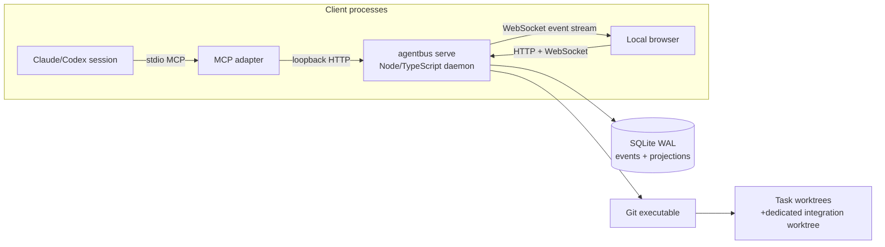
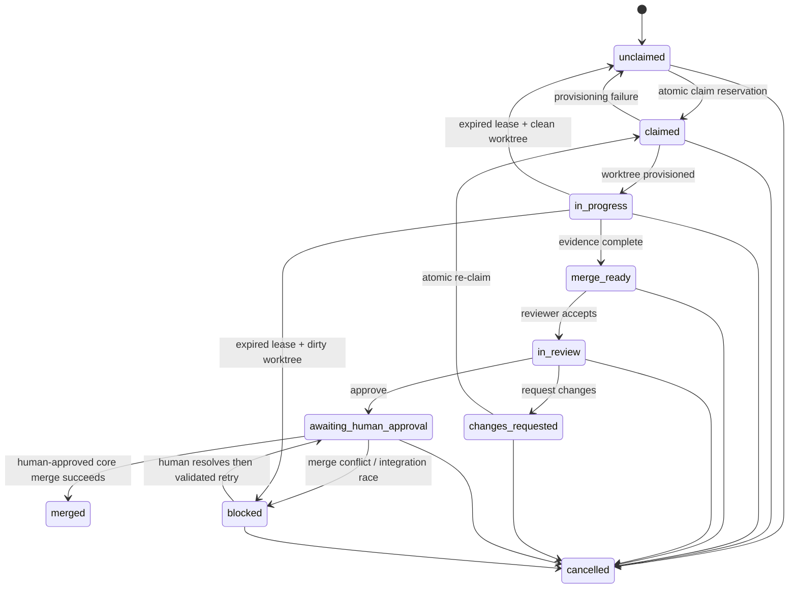

# Architecture: Cross-Agent Collaboration MCP (AgentBus codename)

**Status:** Draft
**Author:** AgentBus architecture
**Date:** 2026-08-13
**PRD:** [Cross-Agent Collaboration MCP](../prd/cross-agent-collaboration-mcp.md)
**Related ADRs:** [ADR 0001](../adrs/0001-sqlite-event-log-and-fenced-leases.md), [ADR 0002](../adrs/0002-core-owned-worktrees-and-human-gated-integration.md)

## Context

AgentBus is a local-first coordination substrate for independently launched coding-agent CLIs working on one Git repository. A Node/TypeScript daemon is the authoritative board: it persists sessions, vendor-neutral role bindings, tasks, leases, messages, review/merge records, self-reported usage, and an immutable event history. An MCP stdio adapter and a thin browser UI are sibling clients of that daemon. The MVP proves one Claude Code Lead/Reviewer and two Codex Workers on Linux and macOS, while keeping profiles and roles vendor-neutral.

The design deliberately confines concurrency to two places: short SQLite transactions for coordination state and serialized Git operations for a repository. Agents never write the board database or create worktrees. A long-poll wakes an idle session, but holds no task authority; only an atomic successful claim creates a fenced lease and an isolated worktree.

## High-level diagram



## Components

| Component | Responsibility | Implements (Req IDs) | Notes |
|---|---|---|---|
| `agentbus serve` daemon | Validates repo/config; owns commands, event projections, long-poll waiters, HTTP/UI, and recovery | `SESSION-01`–`05`, `TASK-02`–`07`, `EVENT-01`–`03` | Explicit startup; one daemon per repository. |
| SQLite store | Event append, idempotency, task/session/lease/message/review/usage projections | `SESSION-02`, `CLAIM-03`, `CLAIM-06`–`07`, `NFR-REL-01`–`02` | Repository-scoped WAL database; ADR 0001. |
| MCP stdio adapter | Maps vendor-neutral MCP tools to daemon commands; owns no board state | `SESSION-03`–`04`, `TASK-01`, `TASK-04`, `CLAIM-01`–`08`, `COLLAB-01`–`03`, `REVIEW-01`–`03` | A separately launched local stdio process per agent configuration. |
| Git worktree/integration service | Creates task worktrees, checks cleanliness, performs guarded merges and cleanup | `WORKTREE-01`–`05`, `MERGE-01`–`05`, `NFR-SEC-02` | Argument-array subprocesses only; ADR 0002. |
| Browser UI | Displays projections and event stream; sends human-only commands | `ROLE-02`–`04`, `UI-01`–`03`, `USAGE-02` | Thin static SPA served by daemon; never routes through MCP. |
| Configuration/profile loader | Validates role bindings, integration branch, lease/poll limits, and agent profile metadata | `ROLE-01`, `NFR-COMPAT-01`–`02`, `NFR-PLATFORM-01` | Profiles are data, not vendor fields in core schema. |

## State, transactions, and fencing

### Task state machine



`claimed` is an internal provisioning reservation and is never returned as usable authority. The core moves to `in_progress` only after the Git worktree exists and then activates the lease. `blocked` has a recorded reason (`dirty_expired_worktree`, `merge_conflict`, `integration_ref_changed`, or an actionable Git failure); cancellation is forbidden after `merged`.

Every state-changing HTTP command and MCP tool receives a UUID `operation_id`. In one `BEGIN IMMEDIATE` transaction the daemon: checks `operation_id` uniqueness; reads the current projection; validates state, actor and role; where applicable validates `lease_id`, `lease_epoch`, `active=1`, and `expires_at > core_now`; appends the event; updates projections; and commits. Repeated operation IDs return the original result without another transition. Rejected commands change no projection and are logged with the operation ID and reason at warning level; accepted commands alone enter the immutable event log.

Claim is two phase to keep Git outside the database write lock:

1. `BEGIN IMMEDIATE` selects one dependency-satisfied, role-eligible task in `unclaimed` or `changes_requested` and conditionally reserves it as `claimed`; it creates a pending lease with random `lease_id` and `lease_epoch = prior_epoch + 1`, then appends `task.claim_reserved`.
2. Outside the transaction, the core creates the branch/worktree. If it fails, a compensating transaction deactivates the pending lease, returns the task to its previous claimable state, and appends `worktree.provision_failed`; no lease/path is returned.
3. On success, a second transaction records branch/path, activates the lease, transitions to `in_progress`, writes the claim-time usage checkpoint, and appends `worktree.provisioned` and `lease.activated`. Only this response contains the lease and absolute path.

Heartbeat extends `expires_at` only for the matching active fence. A periodic expiry worker uses the same transaction rules: it deactivates the exact active lease; runs a non-destructive `git status --porcelain` check outside the transaction; then reopens a clean task or blocks a dirty one in a new fenced transaction. Any later command bearing that fence is rejected. Human reassignment first revokes the prior lease and increments the fence before offering/claiming work, so two valid leases cannot coexist.

### Long-poll activation

`wait_for_next_work` has a default 90-second and configurable maximum 120-second server-held wait, below the 130-second successful proving spike. It returns `{ kind: "task", task }` when a matching claim/review candidate appears, or `{ kind: "timeout" }`; it never claims, leases, or renews work. The supported profile instruction is to immediately repeat it after a timeout or losing a claim, with bounded exponential retry after transport errors. An `AbortSignal`, client disconnect, daemon shutdown, or timer removes the in-memory waiter without a database write. Held calls are capped per session at one and globally by configuration. Repeated wait/return/re-call coverage is a release gate; short-poll and MCP Tasks are documented fallback paths if a supported client regresses.

## Data flow

1. The developer runs `agentbus serve --repo <path>`. The daemon resolves the Git top-level, refuses a non-repository, validates the integration branch and configuration, opens `<repo>/.agentbus/state.sqlite`, creates a loopback listener, restores projections, expires/reconciles leases, and serves the UI.
2. Each MCP adapter calls `register_agent_session` with a durable logical `agent_id`, declared profile, capabilities, and requested configured roles. The daemon creates a distinct `session_id`, applies project role bindings, and records `session.registered`; multiple sessions may use one profile.
3. The Lead calls `create_task`. The command validates complete handoff context, dependencies, expected file scope, and eligible abstract role, detects overlap with concurrently eligible tasks, appends an event, and wakes matching waiters. Tools expose summaries or a single task context only—never the whole board.
4. A Worker already waits. When offered metadata it calls `claim_task`; the two-phase claim creates a core-derived branch and worktree. The Worker receives its absolute path only after the worktree succeeds, then heartbeats and posts lease-fenced progress/messages.
5. The Worker records its completion usage checkpoint and calls `mark_merge_ready` with result summary, recorded branch, and structured test evidence. The daemon validates all required evidence, writes events/projections, and wakes eligible reviewer waiters.
6. A Lead/Reviewer accepts review, sees only that task's context/history, and either requests changes (returning it to the eligible role) or approves it. Approval yields `awaiting_human_approval`, never a merge.
7. The UI displays events through a WebSocket cursor stream and sends a human-authenticated approval. The core serializes a merge in its detached integration worktree, records the source/target revisions and outcome, atomically advances the integration ref, then marks `merged`. A conflict becomes `blocked`, alerts the UI, and is never sent to an agent for autonomous resolution.
8. On restart, projections are validated/rebuilt from events and valid leases are retained. An expired lease follows clean-requeue versus dirty-block policy; worktrees and merge attempts remain inspectable until safe human cleanup.

## Data model

SQLite schema is private to the daemon; query projections make reads inexpensive while `events` remains the audit source.

| Entity | Key fields / relationships |
|---|---|
| `repositories` | Canonical Git root, stable repository UUID, integration ref, validated worktree root, schema version. One database per repository. |
| `agent_profiles`, `role_bindings` | Profile name, capability tags, optional cost tier, configured abstract roles; UI overrides have actor and event linkage. No required vendor column. |
| `agents`, `sessions` | Durable logical `agent_id`; unique `session_id`; profile, capabilities, observed status, last-seen timestamp. A profile has many sessions. |
| `tasks`, `task_dependencies`, `task_file_scopes` | UUID, lifecycle state, self-contained context, eligible role, current assignee/fence, branch/worktree metadata, dependency edges, normalized declared scope patterns. |
| `leases` | `task_id`, `lease_id`, `lease_epoch`, `session_id`, activation/expiry timestamps, active/revoked reason. Unique active lease per task. |
| `messages`, `reviews`, `test_evidence`, `usage_checkpoints` | Ordered task-local collaboration data; evidence is command/outcome/timestamp; paired checkpoints compute a labeled estimate delta. |
| `merge_attempts`, `worktrees` | Source branch, target ref/revision, integration worktree, human actor, outcome/conflict evidence; task worktree cleanliness and cleanup history. |
| `events`, `operations` | Monotonic sequence, event type, actor/session/task, timestamp, JSON payload, operation ID; unique repository operation ID and retained response digest/result. |

Messages/event payloads store structured, bounded fields. Full task context is stored once on the task and is not duplicated into default daemon logs. Event payloads reference it where practical.

## Key interfaces

### Configuration and process surface

`agentbus serve --repo <path> [--config <path>]` is explicit. It writes local state below `<repo>/.agentbus/` (database, lock/pid, restricted local capability secret) and derives worktrees beneath a validated sibling root such as `<repo-parent>/.agentbus-worktrees/<repo-id>/`. The configuration file contains only vendor-neutral roles and profile metadata:

```toml
integration_branch = "main"
lease_seconds = 900
wait_seconds = 90
max_wait_seconds = 120

[roles]
lead = ["lead-profile"]
worker = ["worker-profile"]
reviewer = ["lead-profile"]

[profiles.lead-profile]
capabilities = ["task.create", "task.review"]
[profiles.worker-profile]
capabilities = ["task.implement"]
```

The proving setup names Claude/Codex profiles in project configuration, but those names are opaque labels; no core interface branches on them.

### Local daemon HTTP and WebSocket

The daemon binds `127.0.0.1` and `::1` only. JSON commands use `POST /v1/...` and include `operation_id`; reads use `GET` endpoints. The browser and adapter present a daemon-created local capability token, stored with owner-only permissions, to prevent accidental local cross-origin access. This is not an authorization boundary against another process running as the same OS user; remote/multi-user authentication is out of scope.

| Surface | Essential operations |
|---|---|
| Sessions | `POST /v1/sessions`, `POST /v1/sessions/{id}/status`; `GET /v1/sessions` for UI. |
| Tasks | Create, summary-by-assignment, one-task context/history, lease-fenced transition, messages, evidence, usage checkpoint, heartbeat, cancel/reassign. |
| Human UI | Role/assignee override, review inspection, merge approve/reject/retry, worktree cleanup. Human commands are tagged `actor_type=human`. |
| Events | `GET /v1/events?after=<sequence>` and `GET /v1/events/ws?after=<sequence>`; WebSocket sends ordered events, and client refetches on a sequence gap. |

### MCP tools

The MCP adapter has an ephemeral adapter credential but registration is the durable identity handshake. It does not expose raw HTTP, filesystem, Git, merge, or full-board tools.

| Tool | Caller / result |
|---|---|
| `register_agent_session` | Any agent; sends agent ID, profile, capabilities, requested roles; returns session ID and effective role bindings. |
| `wait_for_next_work` | Idle Worker or Reviewer; bounded task-or-timeout result only. |
| `claim_task` | Eligible Worker; requires task ID + operation ID; success returns task summary, `{lease_id, lease_epoch}`, branch, and absolute core-created worktree. |
| `heartbeat`, `get_my_assigned_tasks`, `get_task_context` | Lease health and minimal task reads; lease-bound commands include the fence. |
| `create_task`, `post_task_message`, `record_usage_checkpoint`, `mark_merge_ready` | Lead creates self-contained work; valid lease holder reports task-local state/evidence. |
| `accept_review`, `approve_review`, `request_changes` | Lead/Reviewer receives, inspects, and records review. `approve_review` cannot merge. |

## Technology choices

| Choice | Selected | Alternatives considered | Rationale |
|---|---|---|---|
| Runtime/language | Node.js LTS + strict TypeScript | Go; Python; vendor CLI plug-ins | Matches MCP ecosystem and supports one portable local codebase; TypeScript contracts can be shared by daemon, adapter, and UI. |
| Store | SQLite WAL via a maintained synchronous driver | PostgreSQL; JSON files; in-memory state | One local daemon needs durable ACID transactions without a service. Keep Git outside short write transactions. |
| Core API | Fastify HTTP server with JSON Schema validation | Express; Hono; direct MCP-only server | Mature Node lifecycle/error handling and explicit local UI/adapter sibling boundary. |
| UI live transport | Native WebSocket endpoint plus HTTP snapshots | SSE; polling; UI through MCP | Bidirectional browser actions and replay cursor satisfy live view without polling; MCP is not a browser UI protocol. |
| Agent transport | MCP stdio adapter to loopback daemon HTTP | Streamable HTTP MCP; per-vendor integration | Stdio is broadly supported by proving clients and isolates MCP lifecycle from daemon/UI state. |
| Git integration | `execFile`/spawn with fixed argument arrays and a dedicated detached integration worktree | shell commands; primary worktree merge; libgit2 | Uses installed Git's worktree behavior, avoids shell injection, and preserves developer worktree safety. |
| Activation | 90 s bounded long-poll, max 120 s | tight polling; MCP Tasks now | Directly proven for target versions at 130 s; bounded calls clean up naturally. MCP Tasks remains a future compatibility fallback. |

## Cross-cutting concerns

- **Error handling strategy:** Typed command errors (`invalid_transition`, `stale_lease`, `conflict`, `validation`, `git_failure`) include operation ID; Git stdout/stderr is capped, structured, and task-linked.
- **Logging / observability conventions:** JSON logs include timestamp, repository ID, operation ID, actor/session/task IDs, duration and outcome; redact capability tokens and omit task context/message bodies by default.
- **Auth / authorization:** Loopback plus a local capability token; human-only commands are only issued by the UI. Same-user local processes are trusted in MVP; no remote listener or outbound service exists.
- **Caching strategy:** SQLite projections are source for reads; UI holds only a replayable view cache keyed by event sequence. No distributed cache.
- **Configuration / secrets:** Validated TOML configuration; generated capability secret is local, owner-only, never exported/logged. Agent provider credentials are outside AgentBus.
- **Internationalization / locale:** N/A for MVP; timestamps are UTC and rendered in browser locale.
- **Background jobs / async work:** In-process lease-expiry/reconciliation timer and per-repository serialized Git queue; waiters are cancellable in-memory resources, not jobs.

## Deployment topology

One `agentbus serve` process runs on the developer's machine for one canonical Git root. It owns `.agentbus/state.sqlite`, listens only on loopback, serves static UI assets, and starts no agent CLIs. Each agent CLI launches its own stdio MCP adapter process configured to reach that daemon. Task worktrees are sibling directories so they are distinct from the developer's primary worktree; a separate detached integration worktree is used for every sequential merge attempt.

The scaling axis is concurrent local sessions (MVP validates four). SQLite serializes writes; held waits use no database transaction; Git operations serialize per repository. Process crash is a daemon failure domain only: state and events persist, and restart reconciliation handles stale pending provisioning, lease expiry, and retained worktrees. Linux/macOS are supported; Windows startup explicitly refuses with an actionable unsupported-platform message.

## Observability

The UI shows a task's latest event, lease countdown, session observed state, worktree/branch, review/merge gate, and usage-pair status. The WebSocket event sequence is the freshness metric; server records accepted-to-published latency and reconnect/replay count.

Release dashboards/acceptance report must include: non-wait/non-Git API p50/p95, event-to-UI p95, claim collision winner count, stale-fence rejections, lease expiration outcome (clean/dirty), held-wait cancellation count, Git failures/merge conflicts, recovery replay duration, and checkpoint-pair completeness. Initial SLOs are under 200 ms p95 for normal API commands and under one second p95 event visibility on the specified four-session reference machine. Test logs record the machine specification and supported Claude Code/Codex versions, but no prompts, secrets, or full contexts.

## Security

Trust boundaries are (1) untrusted task/config text supplied by agents, (2) the daemon's validated board/Git boundary, (3) browser UI on loopback, and (4) Git repository/worktree filesystem. The core canonicalizes the repository top-level; accepts only configured integration refs; derives branch and worktree names from internal UUIDs; confirms paths remain under its configured worktree root; and invokes Git with `execFile` argument arrays and a controlled `cwd`. It never accepts an agent-selected worktree path, branch ref, shell fragment, or merge command.

Threat summary: a stale or racing agent is contained by transaction checks and lease fences; a malformed Git input is contained by allowlists/canonical paths/no shell; an accidental UI cross-origin request is contained by loopback capability token and origin checks; daemon crash is contained by acknowledged-event durability and recovery; conflict resolution is not delegated to an agent. A malicious process running as the same OS user can read local files or connect to loopback and is outside MVP's no-auth boundary; remote access is not implemented. Coordination data never leaves local storage unless an explicit future export feature is added, and the daemon makes no outbound network calls.

## Risks

| Risk | Likelihood | Impact | Mitigation |
|---|---|---|---|
| Long-poll behavior regresses in a client update | Medium | High | Pin/prove supported versions, 90/120 s bounds, cancellation/retry E2E test; fall back to polling or MCP Tasks by profile. |
| Worktree/merge behavior differs on macOS/Linux Git versions | Medium | High | Use Git CLI, test both platforms, validate startup prerequisites, retain all failed artifacts. |
| SQLite projection/event migration bug | Low | High | Versioned migrations, backup before migration, replay/restart tests, no direct DB writes. |
| Dirty expired worktree loses useful changes | Medium | High | Never auto-clean dirty worktree; block and require human reassignment. |
| File-scope declarations are incomplete | High | Medium | Warn on declared overlaps; Lead uses orthogonal scopes/dependency ordering; human merge gate catches integration failures. |
| Same-user local process abuses loopback endpoint | Low | Medium | Capability token and no remote bind; document that OS-user isolation is not a security boundary in MVP. |
| UI falls behind event stream | Medium | Medium | Sequence cursor/replay API, reconnect metrics, snapshot refetch on gap. |

## Alternatives considered

- **Cloud/multi-user coordinator:** rejected for MVP because it violates local-only state, outbound-network, and no-account constraints. The command/event boundary keeps a future remote transport possible.
- **UI as an MCP client:** rejected because browser supervision needs a durable live view and human-only commands independent of agent MCP lifecycle.
- **Mutable Kanban tables only:** rejected because auditable history, replay, idempotency, and restart reconstruction need an append-only record plus projections.
- **Agent-created/shared worktrees:** rejected because it cannot safely control paths or parallel edits; core-owned isolated worktrees are the enforcing primitive.
- **Agent-approved or autonomous merge:** rejected because the PRD requires an explicit human merge authorization and conflict resolution is unsafe to automate.
- **Short polling or experimental MCP Tasks for activation:** rejected for the initial path because bounded held calls were empirically proven for Claude Code/Codex; both remain fallback designs for profiles that do not tolerate the supported loop.

## First implementation story

**Story 001 — daemon, durable task ledger, and safe claim foundation.** Create the Node/TypeScript workspace and `agentbus serve` command; validate a Git root and Linux/macOS support; create/open repository-local SQLite WAL state with migrations; implement event/operation tables and task/session/lease projections; expose loopback health, registration, task creation, one-task context, and atomic two-phase `claim_task`; create a derived task branch/worktree through argument-array Git calls; add heartbeat fencing, basic expiry recovery, and tests for duplicate operation IDs, two-way claim collision, provisioning failure, stale lease rejection, and restart durability. It intentionally excludes the MCP adapter, long-poll, UI/WebSocket, review, and merge workflow so the first implementation is small and verifies the load-bearing persistence/safety contract first.

## Requirement traceability

| Req ID | Covered by | Status |
|---|---|---|
| `SESSION-01` | `agentbus serve` startup validation | Designed |
| `SESSION-02` | Repository SQLite + loopback daemon | Designed |
| `SESSION-03` | Registration handshake/session projection | Designed |
| `SESSION-04` | Session model and MCP adapter | Designed |
| `SESSION-05` | Observed session state/UI projection | Designed |
| `ROLE-01` | Validated role/profile configuration | Designed |
| `ROLE-02` | Human UI override command | Designed |
| `ROLE-03` | Reassignment revocation/fence transaction | Designed |
| `ROLE-04` | Human-only role binding command | Designed |
| `TASK-01` | Lead `create_task` command/schema | Designed |
| `TASK-02` | State machine/projection | Designed |
| `TASK-03` | Dependency-filtered offers/claims | Designed |
| `TASK-04` | Minimal MCP read tools | Designed |
| `TASK-05` | Command validation + event transaction | Designed |
| `TASK-06` | File-scope overlap warning | Designed |
| `TASK-07` | Human cancellation/revocation/retention | Designed |
| `CLAIM-01` | Bounded `wait_for_next_work` | Designed |
| `CLAIM-02` | Profile activation loop contract | Designed |
| `CLAIM-03` | `BEGIN IMMEDIATE` conditional reservation | Designed |
| `CLAIM-04` | Two-phase claim success response | Designed |
| `CLAIM-05` | Waiter/lease separation | Designed |
| `CLAIM-06` | Fence-checked heartbeat | Designed |
| `CLAIM-07` | Expiry reconciliation clean/dirty paths | Designed |
| `CLAIM-08` | Abortable in-memory waiters | Designed |
| `WORKTREE-01` | Core-only Git service | Designed |
| `WORKTREE-02` | Internally derived distinct paths/branches | Designed |
| `WORKTREE-03` | Provisioning compensation | Designed |
| `WORKTREE-04` | Worktree projection/context/UI | Designed |
| `WORKTREE-05` | Cleanliness-guarded cleanup | Designed |
| `COLLAB-01` | Lease-fenced task messages | Designed |
| `COLLAB-02` | Task-local ordered history | Designed |
| `COLLAB-03` | `merge_ready` evidence validation | Designed |
| `USAGE-01` | Claim/completion checkpoint pairing | Designed |
| `USAGE-02` | UI estimated usage status | Designed |
| `USAGE-03` | No usage routing/enforcement logic | Designed |
| `REVIEW-01` | Reviewer offer/accept/context tools | Designed |
| `REVIEW-02` | Approval to human gate only | Designed |
| `REVIEW-03` | Requested-changes transition/re-offer | Designed |
| `MERGE-01` | Human UI authorization | Designed |
| `MERGE-02` | Recorded integration merge attempt | Designed |
| `MERGE-03` | Blocked conflict and human alert | Designed |
| `MERGE-04` | Core-observed successful merge gate | Designed |
| `MERGE-05` | Validated human-resolved retry | Designed |
| `UI-01` | Task/session projection dashboard | Designed |
| `UI-02` | WebSocket sequence stream | Designed |
| `UI-03` | Required human action commands | Designed |
| `EVENT-01` | Immutable accepted-command events | Designed |
| `EVENT-02` | Unique operation ID/result replay | Designed |
| `EVENT-03` | Durable projections/replay recovery | Designed |
| `NFR-PERF-01` | Short transactions, benchmarks | Designed |
| `NFR-PERF-02` | WebSocket events + latency telemetry | Designed |
| `NFR-REL-01` | Transactions, fences, idempotency | Designed |
| `NFR-REL-02` | SQLite WAL committed-event durability | Designed |
| `NFR-SEC-01` | Loopback/no-outbound topology | Designed |
| `NFR-SEC-02` | Canonical paths, allowlists, no shell | Designed |
| `NFR-SEC-03` | Repository-local storage/no export | Designed |
| `NFR-OBS-01` | Redacted operation-correlated logs | Designed |
| `NFR-COMPAT-01` | Vendor-neutral schemas/roles | Designed |
| `NFR-COMPAT-02` | Profile adapter + proving matrix | Designed |
| `NFR-PLATFORM-01` | Linux/macOS contract, Windows refusal | Designed |
| `NFR-COST-01` | Embedded local-only deployment | Designed |

## Open questions

- [ ] `OQ-01`: Select the public product name before release; `AgentBus` remains the non-blocking codename.
- [ ] Choose the exact supported Node.js LTS and Claude Code/Codex versions when implementation begins, then pin them in the compatibility test matrix.
